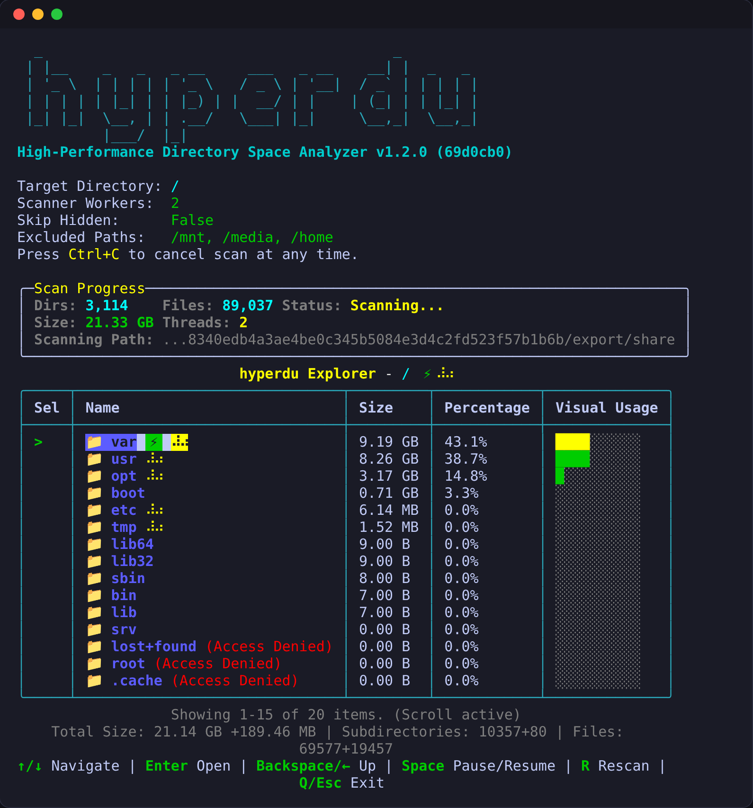
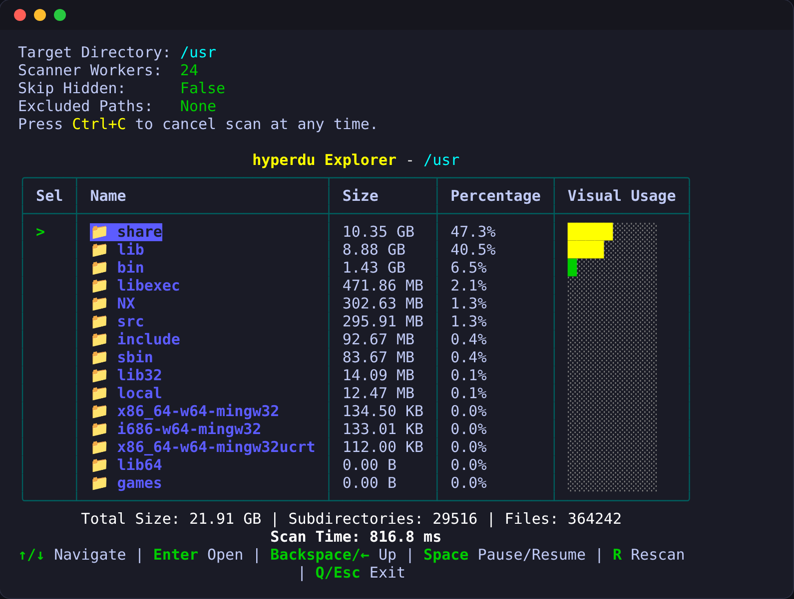
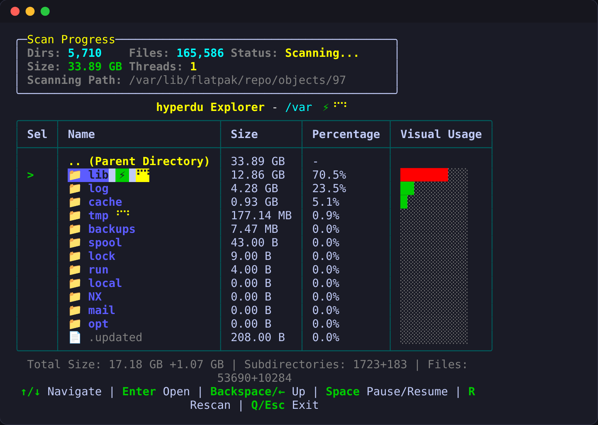

# hyperdu

A terminal disk usage explorer for big directory trees and slow filesystems. Written in C# on .NET 10, runs on Linux, macOS and Windows.

You can browse while it scans. The folder you are looking at gets scanned first, so you don't have to wait for the whole disk before you can open a directory.

[](LICENSE)
[](https://www.nuget.org/packages/hyperdu/)
[](https://github.com/microsoft/winget-pkgs/tree/master/manifests/j/JaretVarn/hyperdu)
[](#)
[](https://dotnet.microsoft.com/)
[](https://jav76.github.io/hyperdu/)
[](https://jav76.github.io/hyperdu/)
[](https://jav76.github.io/hyperdu/)
[](https://jav76.github.io/hyperdu/)
[](https://jav76.github.io/hyperdu/)
[](https://jav76.github.io/hyperdu/)
[](https://jav76.github.io/hyperdu/)



## Features

- **Scans in parallel** across a pool of worker threads, using direct libc calls on Linux and macOS.
- **Scans what you look at first.** The open folder and the highlighted folder jump ahead of the rest of the queue (marked with `⚡`).
- **Tunes thread count to the disk**: more threads on network mounts (NFS, SMB, SSHFS and others; Linux only) to hide latency, one thread on spinning HDDs (Linux and Windows) to avoid seek thrashing.
- **Shows live progress**: per-folder spinners, `+size` / `+files` deltas and a scan time when each folder finishes.
- **Pause, resume and rescan** without restarting.
- **Skips** Linux pseudo-filesystems (`/proc`, `/sys`, `/dev`, `/run`), and optionally hidden files or paths you exclude.



## Install

**WinGet** (Windows):

```powershell
winget install JaretVarn.hyperdu
```

**.NET tool** (any platform with the .NET 10 runtime; for `hyperdu` TUI and `hyperdu du`, not a `du` drop-in):

```bash
dotnet tool install -g hyperdu
```

### Release binaries

Self-contained Native AOT binaries for Linux and macOS (x64, arm64) and Windows (x64, x86) are attached to each [GitHub Release](https://github.com/jav76/hyperdu/releases), along with a `SHA256SUMS` file. They need no .NET runtime and no ICU library. Linux and macOS `.tar.gz` archives include `du` and `gdu` symlinks next to `hyperdu`.

* Linux binaries need glibc 2.28 or newer (RHEL/Alma/Rocky 8, Debian 10, Ubuntu 20.04 and later).
* macOS binaries are not notarized. If Gatekeeper blocks a browser download, run `xattr -d com.apple.quarantine hyperdu`.

```bash
tar -xzf hyperdu-linux-x64.tar.gz
./hyperdu --version
```

## Use as `du`

When invoked as `du` or `gdu` (via symlink on a Native AOT binary), or via `hyperdu du` / `hyperdu gdu`, `hyperdu` runs in non-interactive `du` mode with identical output format and no TUI banner. Running `hyperdu` without a `du`/`gdu` subcommand still launches the interactive explorer.

* **Linux (and `gdu` on all platforms):** runs the **GNU `du` dialect** (1024-byte default blocks, `--apparent-size`, `-b`, `--block-size`, `--exclude`, `--files0-from`, `--inodes`, `--time`, `--max-depth`, and `du (hyperdu) <version>` for `--version`).
* **macOS (`du` symlink / `hyperdu du` on Darwin):** runs the **BSD / macOS `/usr/bin/du` dialect** (512-byte default blocks, `BLOCKSIZE` env var, `-A` apparent blocks, `-B` blocksize, `-g` 1 GiB blocks, `-h` BSD `humanize_number` formatting, `-I` basename ignore mask repeatable, `-n` `UF_NODUMP` filter, `-r`, `-d depth`, `--si`, `-t threshold`, and BSD `usage:` errors). Use `gdu` (or `HYPERDU_DU_DIALECT=gnu`) on macOS when GNU `du` behavior is required.
* **Dialect override (`HYPERDU_DU_DIALECT`):** set `HYPERDU_DU_DIALECT=bsd` or `HYPERDU_DU_DIALECT=gnu` to force a dialect in scripts regardless of symlink name or OS.

### Option A: System-wide install (`/usr/local/bin`, works with `sudo` and scripts)

```bash
sudo mkdir -p /usr/local/bin
sudo tar -xzf hyperdu-linux-x64.tar.gz -C /usr/local/bin hyperdu du gdu
command -v du   # /usr/local/bin/du
du --version
```

On macOS, substitute `hyperdu-osx-arm64.tar.gz` (Apple Silicon) or `hyperdu-osx-x64.tar.gz` (Intel). Passing `hyperdu du gdu` extracts only the binary and symlinks cleanly into `/usr/local/bin` without writing `LICENSE` or `README.md` there (inspect those inside the archive if needed).

### Option B: Current user only (`~/.local/bin`, no root)

```bash
mkdir -p ~/.local/bin
tar -xzf hyperdu-linux-x64.tar.gz -C ~/.local/bin hyperdu du gdu
export PATH="$HOME/.local/bin:$PATH"
```

Add `export PATH="$HOME/.local/bin:$PATH"` to your shell startup file (`~/.profile` or `~/.bash_profile` for login shells, `~/.bashrc` for interactive bash, `~/.zshrc` for zsh) so `~/.local/bin` appears ahead of `/usr/bin`. Verify precedence with `command -v du`. Note that `cron`, `make`, and standalone `#!/bin/sh` scripts typically use a minimal `PATH` (such as `/usr/bin:/bin`) and ignore interactive shell startup files, so use Option A (`/usr/local/bin`) if non-interactive system jobs should pick up `du`.

### Placement rules and caveats

* **Never overwrite `/usr/bin/du`.** `/usr/bin` is owned by your OS package manager (`apt`, `dnf`, `pacman`) or macOS SIP; OS updates will overwrite it or fail integrity checks. Putting `hyperdu`, `du`, and `gdu` in `/usr/local/bin` or `~/.local/bin` ahead of `/usr/bin` overrides `du` cleanly and is easy to remove (`rm -f /usr/local/bin/du /usr/local/bin/gdu /usr/local/bin/hyperdu`).
* **`sudo` uses `secure_path`.** `sudo` resets `PATH` (typically omitting `~/.local/bin`). If `sudo du` or root/cron scripts must resolve to `hyperdu`, install into `/usr/local/bin`.
* **Shell aliases do not affect scripts.** `alias du='hyperdu du'` only applies in interactive shells; scripts, `cron`, `make`, `xargs`, and `find -exec` bypass aliases. Use symlinks on `PATH` instead.
* **Thread control (`HYPERDU_THREADS`).** `du` mode preserves native `du` flags, so override worker count with `HYPERDU_THREADS=<N>` when needed (by default it keeps tiny scans inline, limits rotational Linux HDDs to 1 worker, and scales up on SSDs and network mounts).

### `.NET tool` limitations and wrapper script

`dotnet tool install -g hyperdu` installs a framework-dependent **JIT** shim, so it is **not** a drop-in replacement for `du`:

1. **JIT startup latency:** cold startup takes tens of milliseconds on each invocation, whereas the Native AOT binary starts in ~2-3 ms.
2. **No `argv[0]` dispatch:** the .NET tool host invokes `hyperdu.dll` rather than passing the symlink name, so symlinking `~/.dotnet/tools/hyperdu` to `du` does not activate `du` mode.

For occasional convenience when only the .NET tool is installed, use `hyperdu du ...` directly or save a small wrapper script on `PATH` (note that JIT startup overhead still applies):

```sh
#!/bin/sh
exec hyperdu du "$@"
```

Save that as `~/.local/bin/du` and run `chmod +x ~/.local/bin/du`. Use the Native AOT release archive when replacing `du` in scripts or pipelines.

## Usage

```bash
hyperdu [option]... [path]
```

`path` defaults to the current directory. Short flags align with GNU `du`.

| Option | Description | Default |
|---|---|---|
| `-j, --threads <N>` | Number of scanner worker threads. | CPU cores; `max(32, 2 x cores)` on network mounts; 1 on HDDs |
| `--apparent-size` | Count apparent file sizes instead of allocated 512-byte disk blocks. | Off (allocated blocks) |
| `-b, --bytes` | Count apparent sizes and display exact byte counts. | Off |
| `-h, --human-readable` | Format sizes in binary multiples of 1024. | On (in explorer UI) |
| `--si` | Format sizes in SI powers of 1000. | Off |
| `-t, --threshold <SIZE>` | Hide entries smaller than `SIZE` (`+SIZE` / `SIZE`) or greater than `SIZE` (`-SIZE`). | None |
| `-l, --count-links` | Count hard-linked files multiple times. | Off (deduplicated) |
| `-x, --one-file-system` | Skip directories and targets on different filesystems. | Off |
| `-L, --dereference` | Follow symbolic links. | Off |
| `--exclude <PATTERN>` | Skip files and directories matching glob `PATTERN`. Repeatable. | None |
| `-X, --exclude-from <FILE>` | Read exclude glob patterns from `FILE` (one per line, `-` for stdin). | None |
| `--skip-hidden` | Skip hidden and system files. | Off |
| `-V, --version` | Print the version and exit. | |
| `--help` | Print help and exit. | |

### Migrating legacy TUI flags

`hyperdu` aligned its short flags with `du`:

| Legacy flag | New flag | Notes |
|---|---|---|
| `-t <N>` | `-j <N>` / `--threads <N>` | `-t` now means `--threshold <SIZE>`. |
| `-v` | `-V` / `--version` | Emits a migration error with exit status `1`. |
| `-e <path>` | `--exclude=<pattern>` / `-X <file>` | Uses `du`-style globs across both files and directories. |
| `-h` | `--help` | `-h` now means `--human-readable`. |

Set `HYPERDU_NATIVE_IO=0` to use the .NET file enumerator instead of direct libc calls on Linux and macOS. It is slower and cannot open names that are not valid UTF-8.

### Keys

| Key | Action |
|---|---|
| `↑` / `↓` | Move the selection |
| `Enter` | Open the selected folder |
| `Backspace` / `←` | Go up a level |
| `Space` | Pause or resume scanning |
| `R` | Rescan the selected folder (or the current one) |
| `Q` / `Esc` | Quit |

## How prioritization works

The scan queue has three priority levels:

| Priority | What gets it |
|---|---|
| High | The highlighted folder and everything under it |
| Medium | The folder you opened and everything under it |
| Low | Everything else |

Priorities update as you move, so moving the cursor onto a large folder makes the scanner work on it next.

In the list, a spinner (`⠏⠋`) means a folder is still scanning. `⚡` next to the spinner means it is prioritized. No marker means it is done.

Below, `/var` was opened while `/` was still scanning. `/var` (medium) and the highlighted `lib` (high) are marked `⚡`, and the scanner is already working inside `/var/lib`:



## Building from source

Requires the [.NET 10 SDK](https://dotnet.microsoft.com/en-us/download/dotnet/10.0).

```bash
git clone https://github.com/jav76/hyperdu.git
cd hyperdu
dotnet run --project hyperdu.Cli -- [option]... [path]
```

`./publish.sh` builds self-contained single-file binaries for `linux-x64`, `linux-arm64`, `win-x64`, `win-x86`, `osx-x64` and `osx-arm64` into `publish/`.

Versions come from git tags via [MinVer](https://github.com/adamralph/minver).

## License

[MIT](LICENSE). Copyright (c) 2026 Jaret Varn.
