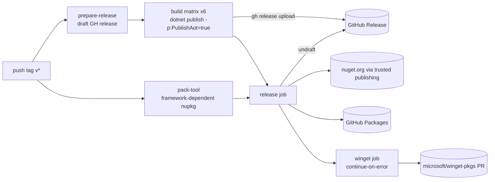
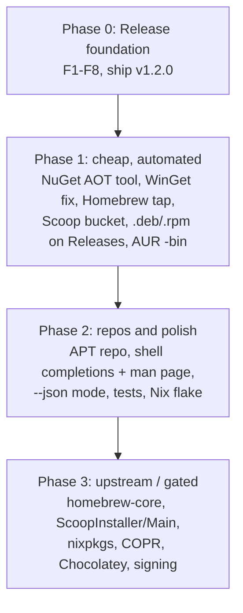

# hyperdu: Status, Roadmap and Publishing Guide

Snapshot taken 2026-11-14 against `main` at `2c7643f` (after PR #6, "upload release assets directly"). Since then PR #21 added a direct libc reader (`statx`/`readdir` on Linux, `fstatat` on macOS) and an xUnit project with a cross-OS `test.yml`; notes below call this out where it matters.

**Phase 0 status:** F1-F7 are implemented on branch `claude/hyperdu-publishing-guide-c54911` and verified locally (section 4). F8, the first release through the new pipeline, has not been cut. Sections 1-2 describe `main` before Phase 0.

1. [What hyperdu has today](#1-what-hyperdu-has-today)
2. [Known gaps found during the survey](#2-known-gaps-found-during-the-survey)
3. [Future enhancements](#3-future-enhancements)
4. [Release foundation (do this before adding channels)](#4-release-foundation-do-this-before-adding-channels)
5. [Publishing channels](#5-publishing-channels)
6. [Recommended rollout order](#6-recommended-rollout-order)
7. [Appendix: secrets and release checklist](#7-appendix-secrets-and-release-checklist)

---

## 1. What hyperdu has today

### Code layout (~2,250 lines of C#)

```text
hyperdu.slnx
├── hyperdu.Core/                         library, net10.0, AllowUnsafeBlocks
│   ├── Models/DirectoryNode.cs           tree node, Interlocked counters, scan timing
│   └── Scanning/
│       ├── ParallelScanner.cs            N workers, local stack + shared queue, batched deltas
│       ├── PrioritizedQueue.cs           3-tier (high/medium/low) queue, live re-prioritization
│       ├── LightweightFileSystemEnumerator.cs  FileSystemEnumerator<T>, no per-file strings
│       ├── DiskDeviceHelper.cs           HDD detection (Linux sysfs, Windows IOCTL)
│       └── ScanOptions.cs
└── hyperdu.Cli/                          exe, PackAsTool, Spectre.Console 0.57
    ├── Program.cs                        arg parsing, worker-count heuristics, network-mount check
    └── UI/InteractiveNavigator.cs        explorer table, keybindings, rescan, pause
```

### Features

| Area | What exists |
| :--- | :--- |
| Scanning | Parallel non-recursive traversal, per-worker local stacks, batched `NodeDelta` flushes, symlinks not followed |
| Prioritization | Viewed dir = medium, highlighted dir = high, everything else = low; re-evaluated on navigation |
| Device heuristics | Network mount -> `max(32, 2*cores)` workers; rotational HDD -> 1 worker; else `cores` |
| UI | Live table with size, %, bar, spinners, `⚡` priority marker, +delta animations, 15-row paging |
| Controls | Arrows, Enter, Backspace, Space (pause/resume), R (rescan subtree), Q/Esc |
| CLI flags | `-h`, `-v`, `-t N`, `-e PATH` (repeatable), `--skip-hidden` |
| Skips | `/proc`, `/sys`, `/dev`, `/run` on non-Windows |

### Platform feature matrix

| Feature | Linux | Windows | macOS |
| :--- | :---: | :---: | :---: |
| Network mount detection | yes (`/proc/mounts`) | no | no |
| Rotational drive detection | yes (sysfs) | yes (`IOCTL_STORAGE_QUERY_PROPERTY`) | no |
| Pseudo-FS skipping | yes | n/a | partial (same Linux path list) |
| Native AOT release binary | x64, arm64 | x64, x86 | x64, arm64 |

### Build and release pipeline (`.github/workflows/publish.yml`)



`sonar.yml` runs SonarQube on every push to `main` (the last run, on `2c7643f`, failed).

### What is actually live

| Channel | Advertised | Actually published | Notes |
| :--- | :--- | :--- | :--- |
| GitHub Releases | v1.1.1 | v1.1.1 | Assets are double-wrapped (`.zip` containing a `.tar.gz`), from the pre-PR #6 flow |
| NuGet (`dotnet tool`) | latest | **0.1.5-rc** | The v1.1.1 `release` job failed, so 1.1.1 was never pushed |
| GitHub Packages | latest | unknown | Same failed job |
| WinGet `JaretVarn.hyperdu` | latest | **0.1.5** | Manifest points at the `v0.1.5-rc` asset |
| Everything else | - | - | brew, apt, rpm, scoop, AUR, nix: not started |

The next tag is the first real test of the PR #6 pipeline.

---

## 2. Known gaps found during the survey

These matter for packaging, so most are prerequisites in section 4.

| # | Gap | Evidence | Impact |
| :--- | :--- | :--- | :--- |
| G1 | Executable is named `hyperdu.Cli` | No `<AssemblyName>` in the csproj; tarball contains `hyperdu.Cli` | Every package manager must rename it; WinGet uses a `PortableCommandAlias` to hide it |
| G2 | Debug symbols ship in archives | linux-x64 tarball: `hyperdu.Cli` 3.7 MB + `hyperdu.Cli.dbg` 6.5 MB + `.pdb` | Archives are ~3x larger than needed |
| G3 | Two version sources disagree | `Directory.Build.props` says `0.1.0`; tags reach `v1.1.1` | Non-tag CI builds are labelled `0.1.0-ci.N` |
| G4 | `--version` prints the commit SHA twice and wraps | `1.1.1+sha.07338c3....07338c3...` | SourceLink already appends the SHA; the workflow adds it again. Breaks clean `brew test` / scripts |
| G5 | ICU is loaded at runtime | Binary contains `libicuuc` lookups; no `InvariantGlobalization` | Minimal containers / distros without `libicu` will fail to start |
| G6 | glibc baseline is 2.34 | `objdump -T` max symbol `GLIBC_2.34` (built on `ubuntu-latest`). Any build host with glibc 2.34+ binds `pthread_*`/`dl*` to 2.34, so `ubuntu-22.04` would not help | Works on Ubuntu 22.04+, Debian 12+, RHEL 9+. Fails on Debian 11, RHEL 8 |
| G7 | No checksums file | Release has no `SHA256SUMS` | Homebrew, Scoop, AUR, Nix all need hashes; today they must be computed by hand |
| G8 | NuGet tool is framework-dependent | `pack-tool` runs plain `dotnet pack` | `dotnet tool install` users need the .NET 10 runtime and get the slower JIT build |
| G9 | No tests (at `2c7643f`) | No test project in `hyperdu.slnx` | Fixed by PR #21 (`hyperdu.Tests`, `test.yml`). Package-manager `test` blocks still only smoke-test `--version` |
| G10 | Lenient arg parsing | Unknown flags become the target path; `-t abc` is silently ignored | Typos produce "directory does not exist" instead of a usage error |
| G11 | README drift | README says the default target is `/`; code uses the current directory | Minor doc fix |
| G12 | Unsigned binaries | No codesign / notarization / Authenticode | macOS Gatekeeper blocks browser-downloaded binaries; SmartScreen warns on Windows |

---

## 3. Future enhancements

Effort: **S** = an evening, **M** = a few days, **L** = a larger project.

### Correctness

| Enhancement | Effort | Why |
| :--- | :---: | :--- |
| Disk usage vs apparent size (`--apparent-size`, default to allocated blocks) | M | Today size = `entry.Length`. Sparse files, compression and small-file block overhead make this differ from `du` |
| Hard-link de-duplication (track dev+inode) | M | Hard-linked files (package caches, `node_modules` stores, backups) are counted once per link |
| `-x` / `--one-file-system` | S | Scanning `/` currently descends into `/mnt`, `/media` and network mounts |
| macOS: verify APFS firmlink handling when scanning `/` | S | `/System/Volumes/Data` may be counted alongside its firmlinked paths (unverified) |
| Strict arg parsing (G10) | S | Fail fast with usage text |

### Interactive UX

| Enhancement | Effort | Why |
| :--- | :---: | :--- |
| Page size from terminal height (replace `PageSize = 15`) | S | Uses the whole terminal; handles resize |
| Sort modes (size, name, count, scan time) | S | Scan-time data already exists in `DirectoryNode` |
| Delete / move to trash with confirmation | M | The main reason people open ncdu-style tools |
| Filter / jump-to-name, `?` help overlay | S | Large directories |
| Open in file manager, copy path | S | Quality of life |

### Output and automation

| Enhancement | Effort | Why |
| :--- | :---: | :--- |
| Non-interactive mode: `--json`, `--csv`, `--top N`, `--depth N` | M | Scripting, CI disk checks, and lets package `test` blocks do real work |
| Export / import scan snapshots | M | Scan once on a server, browse later. An ncdu-compatible export format gives interop for free |
| Diff two snapshots | M | "What grew since last week" |
| Shell completions + man page | S | Expected by brew/apt users; packages install them to standard paths |

### Platform and performance

| Enhancement | Effort | Why |
| :--- | :---: | :--- |
| Network mount detection on macOS (`statfs` `f_fstypename`) and Windows (`GetDriveType == DRIVE_REMOTE`) | S | Brings the worker heuristic to all three OSes |
| Rotational detection on macOS (IOKit) | M | Same |
| `win-arm64`, `linux-musl-x64`, `linux-musl-arm64` targets | S | Windows on ARM, Alpine / containers |
| Windows NTFS MFT reader (admin-only fast path) | L | Order-of-magnitude speedups on NTFS, the WizTree approach |
| Linux `getdents64` / io_uring enumerator | L | Fewer syscalls on huge trees |

### Engineering

| Enhancement | Effort | Why |
| :--- | :---: | :--- |
| Extend `hyperdu.Tests` (PR #21 covers the native reader and scanner): `PrioritizedQueue`, exclusion matching, `DiskDeviceHelper` device-name parsing | M | Safety net before larger changes |
| BenchmarkDotNet or scripted benchmark on a generated tree | S | Proves performance claims release over release |
| Fix the failing Sonar workflow | S | Badges in README currently reflect a failed run |

---

## 4. Release foundation (do this before adding channels)

Each package manager consumes the GitHub Release. Fixing the release once is cheaper than working around it in six manifests.

| Step | Change | Fixes | Status |
| :--- | :--- | :--- | :--- |
| F1 | `<AssemblyName>hyperdu</AssemblyName>` in `hyperdu.Cli.csproj` | G1 | done |
| F2 | `<InvariantGlobalization>true</InvariantGlobalization>`. Side effect: sizes always use `.` as the decimal separator | G5 | done; v1.1.1 aborts on `debian:12-slim` without libicu, the new build runs |
| F3 | Archives hold only the binary, `LICENSE` and `README.md`; `.dbg`/`.pdb`/`.dSYM` go to a 30-day `hyperdu-symbols-<rid>` CI artifact (not a release asset, so `<os>-<arch>` matchers stay unambiguous) | G2 | done |
| F4 | MinVer 8.0.0 in `Directory.Build.props` (tag prefix `v`); "Parse Version" steps and `-p:Version*` flags removed; `fetch-depth: 0`; a guard target fails CI builds that fall back to `0.0.0-alpha.0` or whose version does not match the pushed tag. Also dropped the redundant `Microsoft.SourceLink.GitHub` 8.0.0 package (fixes NU1902) | G3, G4 | done; tag gives `1.2.0`, one commit later `1.2.1-alpha.0.1` |
| F5 | `--version` prints one plain line: `hyperdu 1.2.0 (abc1234)` | G4 | done |
| F6 | `release` job downloads every asset, attaches `SHA256SUMS` (`sha256sum` format), then undrafts. Every upload step refuses to touch an already-published release, so a re-run can never change published hashes | G7 | done (runs on first tag) |
| F7 | Linux binaries are built inside `almalinux:8` (glibc 2.28, pinned multi-arch digest) via `docker run` on the normal runners; CI fails if the binary needs more than `GLIBC_2.28` or references libicu | G6 | done; output needs only `GLIBC_2.17` and completed real scans on CentOS 7, Debian 11, AlmaLinux 8, Ubuntu 20.04, Debian 12-slim. The native reader needs `statx` (glibc 2.28); older glibc falls back to the .NET enumerator |
| F8 | Cut `v1.2.0` and confirm NuGet, WinGet and all assets | Live-status lag | not done (outward-facing, needs the maintainer) |

**WinGet transition (F1 side effect).** The 0.1.5 manifest pins `RelativeFilePath: hyperdu.Cli.exe` with alias `hyperdu`. `winget-releaser@v2` always installs the newest Komac, and Komac 2.17+ rebuilds `NestedInstallerFiles` from the zip and drops `PortableCommandAlias`. The `winget` job now downloads a pinned, checksum-verified Komac 2.17.2, generates the manifest with `--output --exit`, asserts `hyperdu.exe`, both `x64` and `x86`, and hashes matching `SHA256SUMS`, re-adds the alias, and only then submits. Prerelease tags are skipped because a WinGet version can never be reused. Do not resubmit v1.1.1: its Windows zips contain a nested zip.

Suggested asset layout after F1-F6:

```text
hyperdu-linux-x64.tar.gz      -> hyperdu, LICENSE, README.md
hyperdu-linux-arm64.tar.gz
hyperdu-osx-x64.tar.gz
hyperdu-osx-arm64.tar.gz
hyperdu-win-x64.zip           -> hyperdu.exe, LICENSE, README.md
hyperdu-win-x86.zip
hyperdu_1.2.0_amd64.deb       (section 5.4)
hyperdu-1.2.0-1.x86_64.rpm    (section 5.5)
SHA256SUMS
```

Keeping the version out of archive names (as today) is fine; tools like `mise`/`aqua`/`eget` match on `<os>-<arch>` patterns.

### Code signing (optional, recurring cost)

| Option | Pros | Cons | Design Considerations |
| :--- | :--- | :--- | :--- |
| **A: Stay unsigned** | • Free<br>• No secrets in CI | • Gatekeeper blocks browser downloads on macOS<br>• SmartScreen warnings | • Homebrew formulae, WinGet, Scoop and the .NET tool all install without the quarantine/MOTW prompt, so most users never notice |
| **B: Sign macOS only** (Apple Developer ID, notarize) | • Clean direct downloads<br>• Unlocks a Homebrew cask if ever wanted | • Apple Developer Program fee<br>• Notarization step in CI | • Needs macOS runners (already used) and `notarytool` credentials as secrets |
| **C: Sign macOS + Windows** (add Azure Trusted Signing or an OV cert) | • No warnings anywhere | • Two recurring costs<br>• More CI secrets | • Worth it only once direct downloads are a main install path |

**Recommendation: A for now.** Every channel recommended below avoids the quarantine problem; revisit B if direct downloads or a cask become important.

---

## 5. Publishing channels

### Overview

| Channel | Users type | Status | Effort | Who hosts | Automatable |
| :--- | :--- | :--- | :---: | :--- | :--- |
| .NET tool | `dotnet tool install -g hyperdu` / `dnx hyperdu` | live (stale) | S to upgrade | nuget.org | yes, already |
| WinGet | `winget install JaretVarn.hyperdu` | live (stale) | done | microsoft/winget-pkgs | yes, already |
| Homebrew tap | `brew install jav76/tap/hyperdu` | - | S | your tap repo | yes |
| Scoop bucket | `scoop install hyperdu` (after `bucket add`) | - | S | your bucket repo | yes (`autoupdate`) |
| `.deb` / `.rpm` on Releases | `sudo apt install ./hyperdu_*.deb` | - | S | GitHub Releases | yes (nfpm) |
| APT repository | `sudo apt install hyperdu` | - | M | GH Pages / Cloudsmith | yes |
| AUR | `yay -S hyperdu-bin` | - | S | aur.archlinux.org | yes |
| mise / aqua / eget | `mise use -g ubi:jav76/hyperdu` | works after F1-F3 | S | none | n/a |
| Chocolatey | `choco install hyperdu` | - | M | community.chocolatey.org | yes, plus moderation |
| Nix | `nix run github:jav76/hyperdu` | - | M | flake in repo, later nixpkgs | partly |
| Fedora COPR | `dnf copr enable ...` | - | M | copr.fedorainfracloud.org | yes |
| homebrew-core | `brew install hyperdu` | - | M to L | Homebrew | Homebrew's bots |
| Snap | `snap install hyperdu --classic` | - | M | Snap Store | yes, manual review |
| Official Debian/Ubuntu | `apt install hyperdu` (no repo setup) | - | L | distro | no |

Skip Flatpak (sandbox is a poor fit for a whole-disk CLI scanner) and Docker (a container sees only what you mount, which defeats the tool).

---

### 5.1 .NET tool (NuGet)

**Today:** one framework-dependent `hyperdu.<ver>.nupkg`. Needs the .NET 10 runtime, runs JIT.

**Upgrade path (.NET 10 RID-specific AOT tools):** the SDK can publish a small pointer package plus one Native AOT package per RID, with an `any` framework-dependent fallback. `dotnet tool install` and `dnx` pick the right one automatically.

1. In `hyperdu.Cli.csproj`:

   ```xml
   <PublishAot>true</PublishAot>
   <ToolPackageRuntimeIdentifiers>linux-x64;linux-arm64;osx-x64;osx-arm64;win-x64;win-x86;any</ToolPackageRuntimeIdentifiers>
   ```

2. In each `build` matrix job (AOT must be packed on the matching OS), add:

   ```bash
   dotnet pack hyperdu.Cli/hyperdu.Cli.csproj -c Release -r "$RID" -o publish/tool
   ```

3. In `pack-tool`, produce the pointer package and the fallback:

   ```bash
   dotnet pack hyperdu.Cli/hyperdu.Cli.csproj -c Release -o publish/tool
   dotnet pack hyperdu.Cli/hyperdu.Cli.csproj -c Release -r any -p:PublishAot=false -o publish/tool
   ```

4. In `release`, push every `hyperdu.<rid>.<ver>.nupkg` **first**, then `hyperdu.<ver>.nupkg` last. All versions must match exactly, and an install fails if the pointer is live before its RID packages.

Also worth adding: `PackageTags` (`disk-usage;du;ncdu;tui;cli`) and a `PackageIcon`.

**Gotcha:** the `publish.sh` cross-OS fallback cannot produce AOT packages; CI is the only place a complete tool set can be built.

---

### 5.2 WinGet

**Today:** `JaretVarn.hyperdu` exists at 0.1.5. The `winget` job (Phase 0) runs a pinned Komac 2.17.2 with `WINGET_TOKEN` (a classic PAT with `public_repo`; the fork `jav76/winget-pkgs` already exists).

**Remaining work:**

- Get one stable release through the new pipeline so WinGet moves off 0.1.5.
- The rename transition is handled by the Komac-based job (see "WinGet transition" in section 4). Check the first generated PR anyway.
- When `win-arm64` exists, add its URL to the `urls` array and the expected architecture list in the job's assertions.
- WinGet PRs are validated and merged by Microsoft's bots and moderators, usually within a day or two. `continue-on-error: true` is the right call.

---

### 5.3 Homebrew

| Option | Pros | Cons | Design Considerations |
| :--- | :--- | :--- | :--- |
| **A: Own tap, formula over prebuilt binaries** (`jav76/homebrew-tap`) | • Ships today<br>• Covers macOS and Linuxbrew, both arches<br>• Formula installs are not quarantined, so unsigned binaries are fine | • Users type `jav76/tap/hyperdu`<br>• You own the update automation | • One Ruby file, regenerated per release from `SHA256SUMS` |
| **B: homebrew-core, build from source** | • `brew install hyperdu`, bottles built by Homebrew<br>• Homebrew's bots bump versions | • Must build from source with `depends_on "dotnet" => :build`, passing `-p:MinVerVersionOverride=#{version}` (release tarballs have no `.git`)<br>• Must pass Homebrew's acceptance and notability review; a 1-star self-submitted repo is likely to be rejected today<br>• Tracks Homebrew's `dotnet` formula version churn | • Source build means NuGet restore + AOT inside `brew install`; test this in your tap first |
| **C: Cask** | • Simple to write | • Casks are for apps and binary-only software; Homebrew 5.0 deprecated casks that fail Gatekeeper, with disabling scheduled from Sept 2026 | • Only viable after signing option B in section 4 |

**Recommendation: A now, B once the project has traction.** A source-build formula in your own tap is a good rehearsal for B.

Steps for A:

1. Create the public repo `jav76/homebrew-tap` (the `homebrew-` prefix is required for the short `jav76/tap` name).
2. Add `Formula/hyperdu.rb`:

   ```ruby
   class Hyperdu < Formula
     desc "Parallel, dynamically prioritized terminal disk usage analyzer"
     homepage "https://github.com/jav76/hyperdu"
     version "1.2.0"
     license "MIT"

     on_macos do
       on_arm do
         url "https://github.com/jav76/hyperdu/releases/download/v#{version}/hyperdu-osx-arm64.tar.gz"
         sha256 "<from SHA256SUMS>"
       end
       on_intel do
         url "https://github.com/jav76/hyperdu/releases/download/v#{version}/hyperdu-osx-x64.tar.gz"
         sha256 "<from SHA256SUMS>"
       end
     end

     on_linux do
       on_arm do
         url "https://github.com/jav76/hyperdu/releases/download/v#{version}/hyperdu-linux-arm64.tar.gz"
         sha256 "<from SHA256SUMS>"
       end
       on_intel do
         url "https://github.com/jav76/hyperdu/releases/download/v#{version}/hyperdu-linux-x64.tar.gz"
         sha256 "<from SHA256SUMS>"
       end
     end

     def install
       bin.install "hyperdu"
     end

     test do
       assert_match version.to_s, shell_output("#{bin}/hyperdu --version")
     end
   end
   ```

3. Add a non-blocking `homebrew` job after `release`: download `SHA256SUMS`, render the formula from a template, and push to the tap with a fine-grained PAT (`HOMEBREW_TAP_TOKEN`, contents write on the tap repo only).
4. Verify locally: `brew install --build-from-source jav76/tap/hyperdu && brew test hyperdu && brew audit --strict jav76/tap/hyperdu`.

Requires F1 (binary name), F3 (clean archive) and F5 (clean `--version`).

---

### 5.4 Debian / Ubuntu (apt)

| Option | Pros | Cons | Design Considerations |
| :--- | :--- | :--- | :--- |
| **A: `.deb` attached to GitHub Releases** (built with nfpm) | • Trivial to add to CI<br>• `apt install ./file.deb` handles removal cleanly | • No `apt upgrade`; users re-download | • nfpm is a single static binary; also produces `.rpm`, `.apk` and Arch packages from the same config |
| **B: Self-hosted APT repo** (GitHub Pages + `reprepro`/`aptly`, or a hosted service such as Cloudsmith's OSS tier) | • Real `apt install` / `apt upgrade`<br>• Builds on A's `.deb` | • You manage a GPG signing key<br>• Users add a repo + key once | • GitHub Pages keeps it free; a hosted service removes the index/signing work (check current free-tier terms) |
| **C: Launchpad PPA** | • Familiar to Ubuntu users | • Launchpad builds from source **without network access**, so every NuGet package must be vendored<br>• Needs a .NET 10 SDK in the target Ubuntu series archive | • High ongoing friction for a .NET project |
| **D: Official Debian / Ubuntu archive** | • Zero setup for users | • .NET is not in Debian main; Ubuntu packaging requires offline source builds and a sponsor | • Not realistic for now |

**Recommendation: A in the next release, B when you want `apt upgrade`.**

nfpm config (`packaging/nfpm.yaml`), reused for rpm in 5.5:

```yaml
name: hyperdu
arch: ${PKG_ARCH}          # amd64 / arm64; nfpm converts to x86_64 / aarch64 for rpm
version: ${VERSION}
maintainer: Jaret Varn
description: Parallel, dynamically prioritized terminal disk usage analyzer
homepage: https://github.com/jav76/hyperdu
license: MIT
contents:
  - src: ./publish/${RID}/hyperdu
    dst: /usr/bin/hyperdu
    file_info:
      mode: 0755
  - src: ./LICENSE
    dst: /usr/share/doc/hyperdu/copyright
```

CI step in the linux build jobs:

```bash
nfpm package --config packaging/nfpm.yaml --packager deb --target .
nfpm package --config packaging/nfpm.yaml --packager rpm --target .
```

**Gotchas:**

- Do F2 first. Otherwise the package needs a `Depends:` on `libicu`, whose package name differs per release (`libicu72`, `libicu74`, ...).
- With F7 the binary needs only glibc 2.17, so one `.deb` covers every Debian/Ubuntu release still in use.

For option B on GitHub Pages: a `gh-pages` branch holding `dists/` and `pool/`, updated by `reprepro includedeb stable *.deb` in CI, with the GPG key in a secret. Users then run:

```bash
curl -fsSL https://jav76.github.io/hyperdu/apt/key.gpg | sudo gpg --dearmor -o /usr/share/keyrings/hyperdu.gpg
```

```bash
echo "deb [signed-by=/usr/share/keyrings/hyperdu.gpg] https://jav76.github.io/hyperdu/apt stable main" | sudo tee /etc/apt/sources.list.d/hyperdu.list
```

```bash
sudo apt update && sudo apt install hyperdu
```

---

### 5.5 Fedora / RHEL (rpm)

- **Now:** the `.rpm` from the same nfpm config, attached to Releases.
- **Later:** a Fedora COPR project (enable internet access during build so NuGet restore works), giving `dnf copr enable jav76/hyperdu && dnf install hyperdu`.
- RHEL 8 works with the F7 build (glibc 2.28 required, 2.17 in practice).

---

### 5.6 Arch Linux (AUR)

Publish `hyperdu-bin` (prebuilt). A source package `hyperdu` with `makedepends=('dotnet-sdk')` can follow; build it with `-p:MinVerVersionOverride=$pkgver`.

```bash
pkgname=hyperdu-bin
pkgver=1.2.0
pkgrel=1
pkgdesc="Parallel, dynamically prioritized terminal disk usage analyzer"
arch=('x86_64' 'aarch64')
url="https://github.com/jav76/hyperdu"
license=('MIT')
provides=('hyperdu')
conflicts=('hyperdu')
source_x86_64=("$url/releases/download/v$pkgver/hyperdu-linux-x64.tar.gz")
source_aarch64=("$url/releases/download/v$pkgver/hyperdu-linux-arm64.tar.gz")
sha256sums_x86_64=('<from SHA256SUMS>')
sha256sums_aarch64=('<from SHA256SUMS>')

package() {
  install -Dm755 hyperdu "$pkgdir/usr/bin/hyperdu"
  install -Dm644 LICENSE "$pkgdir/usr/share/licenses/$pkgname/LICENSE"
}
```

Setup: create an AUR account, add an SSH key, `git clone ssh://aur@aur.archlinux.org/hyperdu-bin.git`, commit `PKGBUILD` + `.SRCINFO` (`makepkg --printsrcinfo > .SRCINFO`). Automate with an action such as `KSXGitHub/github-actions-deploy-aur` and an `AUR_SSH_PRIVATE_KEY` secret.

---

### 5.7 Scoop (Windows)

Create `jav76/scoop-bucket` with `bucket/hyperdu.json`:

```json
{
  "version": "1.2.0",
  "description": "Parallel, dynamically prioritized terminal disk usage analyzer",
  "homepage": "https://github.com/jav76/hyperdu",
  "license": "MIT",
  "architecture": {
    "64bit": {
      "url": "https://github.com/jav76/hyperdu/releases/download/v1.2.0/hyperdu-win-x64.zip",
      "hash": "<from SHA256SUMS>"
    },
    "32bit": {
      "url": "https://github.com/jav76/hyperdu/releases/download/v1.2.0/hyperdu-win-x86.zip",
      "hash": "<from SHA256SUMS>"
    }
  },
  "bin": "hyperdu.exe",
  "checkver": "github",
  "autoupdate": {
    "architecture": {
      "64bit": { "url": "https://github.com/jav76/hyperdu/releases/download/v$version/hyperdu-win-x64.zip" },
      "32bit": { "url": "https://github.com/jav76/hyperdu/releases/download/v$version/hyperdu-win-x86.zip" }
    },
    "hash": { "url": "$baseurl/SHA256SUMS" }
  }
}
```

Scoop's bucket template repo ships an Excavator workflow that runs `checkver`/`autoupdate` on a schedule, so no release-side job is needed. Once the tool is established, propose it to `ScoopInstaller/Main` (CLI tools) and drop the custom bucket.

Before F1, `bin` would need `[["hyperdu.Cli.exe", "hyperdu"]]` to alias the name.

---

### 5.8 Chocolatey (optional)

Choco overlaps heavily with WinGet and Scoop. Worth it only if you want enterprise/IT reach.

- Package layout: `hyperdu.nuspec` + `tools/chocolateyinstall.ps1` using `Install-ChocolateyZipPackage` with the release URL and checksum (Chocolatey auto-shims the `.exe`).
- Push with `choco push --api-key $CHOCO_API_KEY`. Every version goes through automated checks plus human moderation; first versions can take days.

---

### 5.9 Version-manager installers (free reach)

`mise`, `aqua`, `ubi` and `eget` install straight from GitHub Releases by matching `<os>-<arch>` in asset names. After F1-F3 this works with no extra files:

```bash
mise use -g ubi:jav76/hyperdu
```

Optional: a PR to the `aquaproj/aqua-registry` adds a first-class `aqua g -i jav76/hyperdu` entry.

---

### 5.10 Nix

- **Step 1:** a `flake.nix` in this repo using `buildDotnetModule` (`dotnet-sdk_10`, `nugetDeps = ./deps.json` generated by the package's `fetch-deps` script). Gives `nix run github:jav76/hyperdu`. Nix builds have no `.git`, so add `dotnetFlags = [ "-p:MinVerVersionOverride=${version}" ];`; MinVer ignores the usual `-p:Version`.
- **Step 2:** upstream to nixpkgs (`pkgs/by-name/hy/hyperdu/package.nix`) once the flake is stable. nixpkgs reviewers build from source, and `deps.json` must be regenerated whenever NuGet references change.

---

### 5.11 Snap (low priority)

A whole-disk scanner needs either `classic` confinement (requires a manual review request on the Snap Store forum) or strict confinement with `home`, `removable-media` and `system-files` plugs, which still cannot see everything. Snap users are mostly served by apt and brew already.

---

## 6. Recommended rollout order



- **Phase 0** is mostly csproj and workflow edits; it unblocks everything else.
- **Phase 1** covers macOS, Windows, and the big Linux families with roughly one small repo or CI job each.
- **Phase 2** turns "download a file" into "it updates itself" on Linux and gives packagers better tests.
- **Phase 3** channels have gatekeepers (stars/notability, reviewers, moderation). Apply once there are users.

Keep every package-manager job `continue-on-error: true` and downstream of `release`, as the WinGet job already is, so one broken integration cannot stop the GitHub Release.

---

## 7. Appendix: secrets and release checklist

### Secrets and accounts

| Secret / account | Used by | Scope |
| :--- | :--- | :--- |
| NuGet trusted publishing (`NuGet/login`, user `jav26122`) | `release` | Already configured |
| `WINGET_TOKEN` | `winget` | Classic PAT, `public_repo`; fork of `microsoft/winget-pkgs` |
| `HOMEBREW_TAP_TOKEN` | `homebrew` | Fine-grained PAT, contents write on `jav76/homebrew-tap` |
| `AUR_SSH_PRIVATE_KEY` + AUR account | `aur` | SSH key registered on aur.archlinux.org |
| `APT_GPG_PRIVATE_KEY` (+ passphrase) | `apt-repo` | Signs `Release`/`InRelease` |
| `CHOCO_API_KEY` | `choco` | Optional |
| Apple Developer ID + notarytool creds | macOS signing | Optional (section 4) |

### Per-release checklist

1. Merge to `main`; confirm the `Build and Publish` and Sonar runs are green.
2. Tag `vX.Y.Z` and push.
3. Confirm the GitHub Release has all six archives, `.deb`/`.rpm`, and `SHA256SUMS`, and is no longer a draft.
4. `dotnet tool update -g hyperdu` (or `dnx hyperdu --version`) shows `X.Y.Z`.
5. WinGet PR opened in `microsoft/winget-pkgs`; check `RelativeFilePath` if the archive layout changed.
6. Tap / bucket / AUR commits landed; `brew upgrade hyperdu` shows `X.Y.Z`.
7. Smoke test on one machine per OS: `hyperdu --version`, then `hyperdu ~` and quit.
